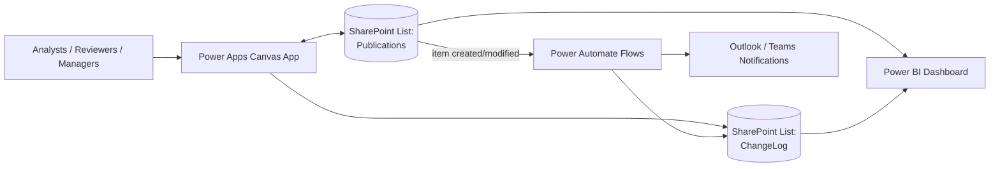
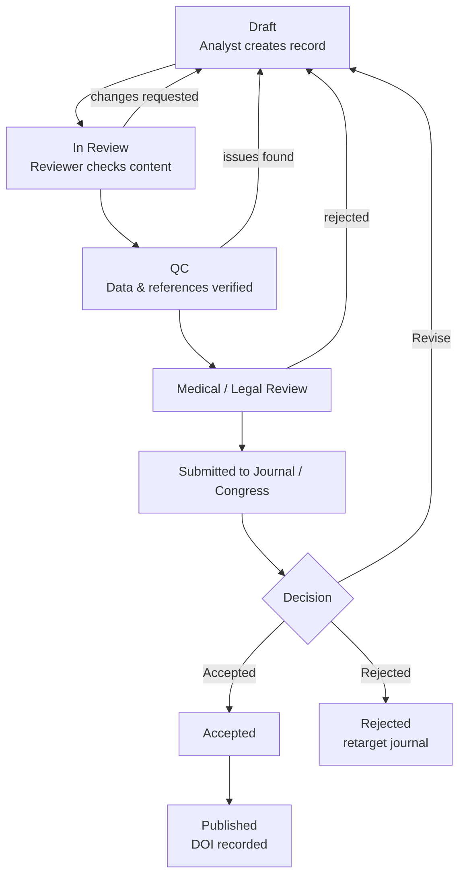

# HEMA Publication Tracker (Power Apps)

A basic Power Platform project that tracks **Health Economics & Market Access (HEMA)** paper publications: the paper's details, where it is in the publication process, and every change made by analysts.

---

## 1. Problem Statement

HEMA teams publish papers (cost-effectiveness models, burden-of-illness studies, budget impact analyses, conference abstracts and posters). Tracking is usually done in Excel sheets passed around by email, which causes:

- No single source of truth for paper status
- No record of **who changed what and when**
- Missed journal or congress deadlines
- Manual status reports for managers

**Solution:** A Power Apps canvas app backed by SharePoint lists, with Power Automate for notifications and audit logging, and an optional Power BI dashboard.

---

## 2. Architecture



| Component | Purpose |
|---|---|
| **SharePoint Online** | Stores publication records and the change log |
| **Power Apps (Canvas)** | User interface for adding, editing, reviewing papers |
| **Power Automate** | Logs changes, sends emails/Teams alerts, sends deadline reminders |
| **Power BI** (optional) | Dashboard of status, timelines, analyst workload |

---

## 3. Data Model

### List 1: `Publications`

| Column | Type | Example |
|---|---|---|
| Title (PaperTitle) | Single line text | Cost-effectiveness of Drug X in Type 2 Diabetes |
| PublicationID | Single line text | HEMA-2026-014 |
| PublicationType | Choice | Manuscript / Abstract / Poster / Podium |
| TherapeuticArea | Choice | Oncology / Diabetes / Cardiology |
| Product | Single line text | Drug X |
| TargetJournal | Single line text | Value in Health / ISPOR Congress |
| LeadAnalyst | Person | Jane Doe |
| Reviewer | Person | Senior HEOR Manager |
| Status | Choice | Draft / In Review / QC / Medical-Legal Review / Submitted / Accepted / Published / Rejected |
| SubmissionDeadline | Date | 2026-12-15 |
| SubmissionDate | Date | |
| PublishedDate | Date | |
| DOI | Single line text | 10.1016/j.jval.2026.01.001 |
| Comments | Multiple lines text | |
| LastModifiedBy / Modified | Built-in | Auto-captured by SharePoint |

### List 2: `ChangeLog`

| Column | Type | Description |
|---|---|---|
| PublicationID | Single line text | Links to the paper |
| FieldChanged | Single line text | e.g. Status |
| OldValue | Multiple lines text | e.g. In Review |
| NewValue | Multiple lines text | e.g. QC |
| ChangedBy | Person | Analyst who made the change |
| ChangedOn | Date and time | Timestamp |
| ChangeReason | Multiple lines text | Optional note entered by analyst |

---

## 4. Publication Workflow



| Stage | Owner | Action in App | Automation |
|---|---|---|---|
| Draft | Analyst | Creates paper record | Email to Reviewer |
| In Review | Reviewer | Approves or sends back with comments | Email to Analyst |
| QC | QC Analyst | Verifies numbers and references | — |
| Medical/Legal Review | Med/Legal | Compliance sign-off | Teams message to Manager |
| Submitted | Analyst | Enters submission date | Reminder stops |
| Accepted / Rejected | Analyst | Records journal decision | Email to team |
| Published | Analyst | Enters DOI and published date | Dashboard updates |

---

## 5. App Screens

1. **Home / Dashboard screen**: counts by status, papers due in the next 14 days
2. **Browse screen**: gallery of all papers with search and filters (Status, Therapeutic Area, Analyst)
3. **Detail / Edit screen**: form to view or edit a paper, plus a "Reason for change" box
4. **Change History screen**: gallery of `ChangeLog` entries for the selected paper

---

## 6. Key Power Fx Formulas

**Browse gallery: search and filter**
```powerfx
SortByColumns(
    Filter(
        Publications,
        (IsBlank(ddStatus.Selected.Value) || Status.Value = ddStatus.Selected.Value) &&
        (IsBlank(txtSearch.Text) || StartsWith(Title, txtSearch.Text))
    ),
    "SubmissionDeadline", SortOrder.Ascending
)
```

**Save button: submit the form**
```powerfx
SubmitForm(frmPublication);
```

**Form OnSuccess: confirm and go back**
```powerfx
Notify("Publication saved", NotificationType.Success);
Back();
```

**Change history gallery for the selected paper**
```powerfx
SortByColumns(
    Filter(ChangeLog, PublicationID = galPublications.Selected.PublicationID),
    "ChangedOn", SortOrder.Descending
)
```

**Papers due in the next 14 days (Home screen)**
```powerfx
CountRows(
    Filter(
        Publications,
        SubmissionDeadline <= DateAdd(Today(), 14, TimeUnit.Days),
        SubmissionDeadline >= Today(),
        Status.Value <> "Submitted"
    )
)
```

**Role-based visibility (e.g. only reviewers see Approve button)**
```powerfx
// App.OnStart
Set(varUserEmail, Lower(User().Email));
Set(varIsReviewer, !IsEmpty(Filter(Reviewers, Lower(Email) = varUserEmail)));

// btnApprove.Visible
varIsReviewer
```

---

## 7. Power Automate Flows

### Flow 1: Audit Log (who changed what)
- **Trigger:** SharePoint *When an item is created or modified* (`Publications`)
- **Action:** *Get changes for an item or a file (properties only)*, using the trigger's previous version
- **Condition:** if `Status` (or other tracked columns) has changed
- **Action:** *Create item* in `ChangeLog` with old value, new value, `Editor` (modified by) and timestamp

### Flow 2: Status Notifications
- **Trigger:** Same as above, filtered to Status changes
- **Switch on Status:** send email or Teams message to the next owner (Reviewer, QC, Med/Legal, Manager)

### Flow 3: Deadline Reminders
- **Trigger:** Recurrence, daily at 9 AM
- **Action:** *Get items* where `SubmissionDeadline` is within 7 days and `Status` is not Submitted, Accepted, or Published
- **Action:** Email the Lead Analyst with the list of upcoming deadlines

---

## 8. Security

- SharePoint permissions: Analysts = Contribute, Managers = Read (or Full Control for admins)
- App shared with a Microsoft 365 / Entra ID security group
- Role checks in the app (Reviewer list or security group) control who can approve
- SharePoint version history is enabled as a second audit trail

---

## 9. Build Steps (Summary)

1. Create the `Publications` and `ChangeLog` lists in a SharePoint site
2. In Power Apps, choose **Create → Start from data → SharePoint → Publications** (auto-generates Browse, Detail, Edit screens)
3. Customize the screens: add filters, a Home dashboard, and a Change History screen
4. Build the three Power Automate flows
5. Test with sample papers through every status
6. Share the app with the HEMA team security group
7. (Optional) Connect Power BI to both lists for reporting

---

## 10. Interview Explanation

### 30-second pitch
> "I built a HEMA Publication Tracker using Power Apps, SharePoint and Power Automate. Our health economics team tracked papers in Excel, so there was no clear status, no audit trail of analyst changes, and deadlines got missed. The app gives one place to log each paper, moves it through a review workflow from Draft to Published, automatically records every change analysts make, and sends reminders before submission deadlines."

### STAR format

| | |
|---|---|
| **Situation** | The HEMA team managed 30+ publications a year (manuscripts, congress abstracts, posters) in shared Excel files. |
| **Task** | Build a low-code tool to centralize tracking, capture analyst changes for audit, and improve deadline visibility. |
| **Action** | Designed two SharePoint lists (Publications, ChangeLog), built a canvas app with browse, edit, history and dashboard screens, and created Power Automate flows for audit logging, status notifications and deadline reminders. Added role-based visibility for reviewers. |
| **Result** | One source of truth for all papers, a full change history per paper, automatic reminders, and status reporting that no longer needed manual Excel updates. *(Use real numbers if you have them, e.g. "saved ~3 hours/week of status reporting".)* |

### Common interview questions and answers

**Q: Why SharePoint instead of Dataverse?**
SharePoint comes with standard Microsoft 365 licensing, so no premium licences were needed, and the data volume is small (hundreds of records). For larger data, complex relationships or row-level security, I would use Dataverse.

**Q: How do you track changes made by analysts?**
Two layers: a Power Automate flow that writes old value, new value, who and when into a `ChangeLog` list, and SharePoint version history as a backup. The app also has a "Reason for change" field so the analyst can explain the edit.

**Q: What is delegation and how did you handle it?**
Delegation means Power Apps pushes the filter to the data source instead of downloading records locally (by default only the first 500 or up to 2,000 rows are processed locally). I used delegable functions with SharePoint, like `Filter` with `=` and `StartsWith`, and avoided non-delegable ones like `Search` or `in` on large lists.

**Q: How do you control who can approve?**
At app start I check whether the current user (`User().Email`) is in a Reviewers list or security group, store that in a variable, and use it to show or hide the Approve button. SharePoint permissions enforce access at the data level as well.

**Q: How are notifications sent?**
A Power Automate flow triggers when an item is modified, checks the new Status with a Switch, and emails or Teams-messages the next person in the workflow. A separate scheduled flow sends daily deadline reminders.

**Q: What would you improve next?**
Move to Dataverse for proper relationships and security roles, add a Power BI dashboard for publication metrics, add approvals using the Power Automate *Approvals* connector, and attach manuscript drafts from a SharePoint document library.

**Q: What challenges did you face?**
Working with Person and Choice columns in Power Fx (they are records, so you use `.Value` or `.DisplayName`), staying within delegation limits, and making sure the audit flow did not trigger itself in a loop. I solved the loop by writing to a separate `ChangeLog` list instead of updating the same item.
